# TeaCoder

> AI 编程 CLI 工具的桌面管理客户端 — Claude Code / Codex CLI / Gemini CLI / OpenCode / Antigravity 的统一管家

[](./LICENSE)
[](https://tauri.app/)
[](https://react.dev/)
[](https://www.typescriptlang.org/)
[](https://www.rust-lang.org/)

<div align="center">
  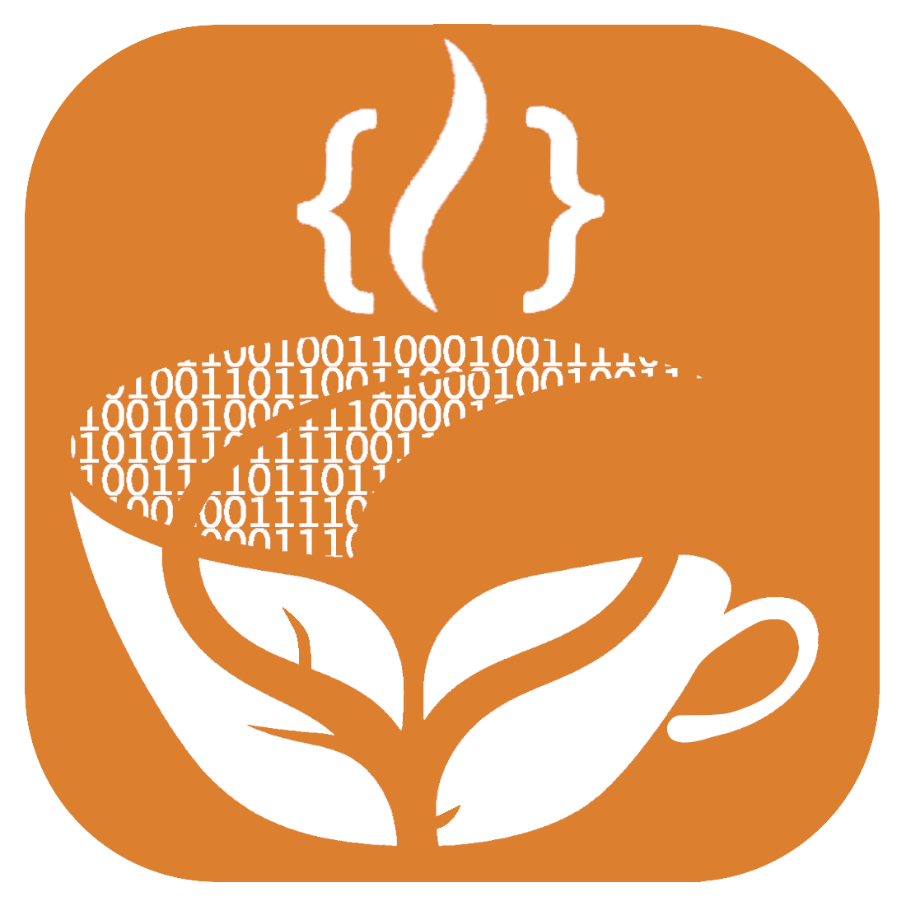

  **动动你发财的小手，给点一颗星星吧！**
</div>


## 项目简介

TeaCoder是一款为 **AI 编程 CLI 工具** 量身打造的桌面管理客户端。它不做 AI 推理，只做"周边设施"——为 Claude Code、Codex CLI、Gemini CLI、OpenCode、Antigravity 提供图形化的会话管理、账号管理、LLM 供应商管理、配置管理。

**核心原则：零额外 Token 开销。** TeaCoder 通过 PTY 直通运行 CLI 工具，**不拦截、不代理任何 API 请求**。Token 统计直接读取各 CLI 工具本地的 JSONL / 数据库，不解析 PTY 输出——CLI 工具的协议怎么变都不会影响 TeaCoder 的统计准确性。


## 核心特性

| 特性 | 说明 |
| --- | --- |
| **多主题** |通用的十多个主题，系统主题与终端主题分离 |
| **多平台支持** |基于Rust+React 的Tauri框架，支持一键发布Linux、Window、IOS平台，x86、 Arm架构 |
| **多标签 + 分屏** | 浏览器式标签 + 最多 2 个 Pane 左右分屏，`共享 PTY 双开`（同一会话两端同步显示） |
| **多工具终端管理** | 同时支持 Claude Code/ Codex CLI/ Gemini CLI/ OpenCode/ Antigravity/ 裸终端/ SSH。自定义不同类似的`快捷输入`/`代码块` |
| **裸终端 / SSH集成sFTP** | 支持SSH帐号记录和登录，基于sFTP的`图形化`上传、下载文件支持，`操作记录持久化` |
| **PTY 直通** | 真实 PTY 伪终端运行，无 API 拦截，`零额外 Token 消耗` |
| **四层会话模型** | Project → SessionCategory → Session + SessionMessage，结构清晰 |
| **LLM 供应商系统** | 会话独立选择模型，多会话多供应商多模型同时运行 |
| **会话历史+搜索+定位**  | 支持用户会话、系统会话查看，关键词搜索。一键`定位`PTY会话窗口位置。 |
| **系统托盘 + 关闭行为** | 可关闭至托盘、可配置开机自启 |
| **Profile 隔离** | 每个 Profile 独立的 `CLAUDE_CONFIG_DIR`，账号数据完全隔离 |
| **凭据分层存储** | Profile 凭据走系统 Keychain，LlmProvider 走 SQLite（Base64 编码） |
| **18 个设置项** | 通用 / 终端 / LLM / 每个 CLI 工具独立 / 网络 / 通知 / 数据管理 / 关于 等 |
| **新手引导** | 首次启动引导流程，快速上手 |

> **注：**
> - Codex CLI/ Gemini CLI/ OpenCode/ Antigravity 相关功能未实现。
> - Window、IOS平台，Arm架构 未实测。本人环境为Linux amd64。
> - 18 个设置项 尚未完全实现。

### 特性图示

#### 通用主题：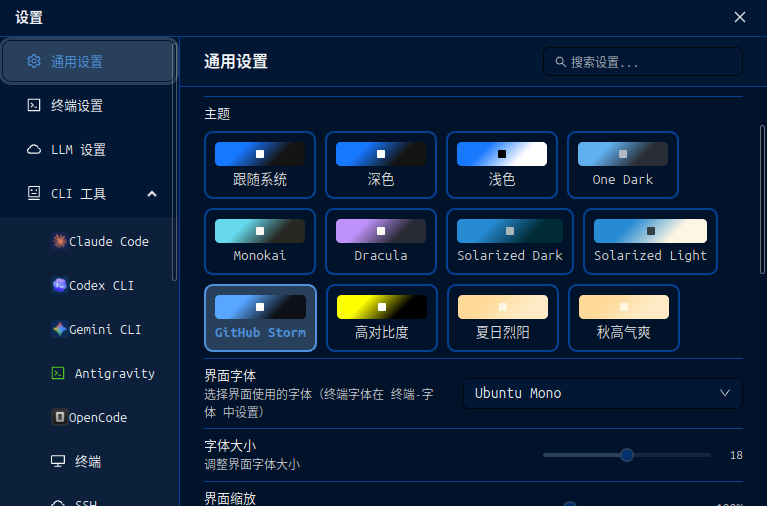
#### 终端主题：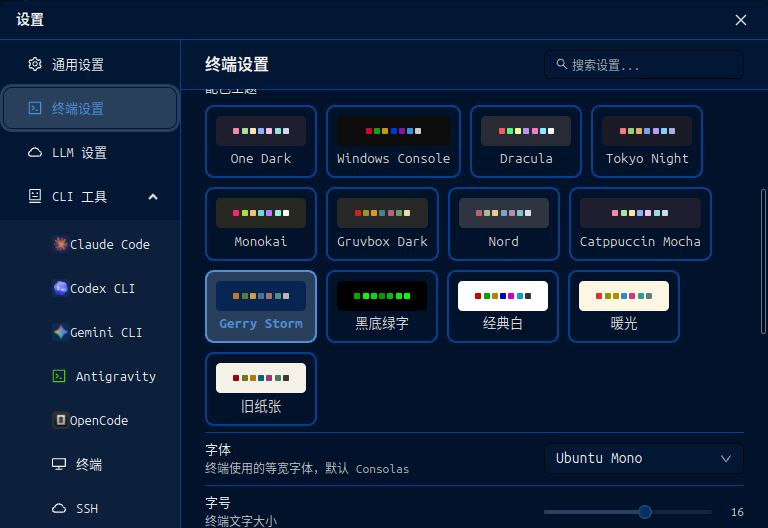
#### 主题示例-蓝色系：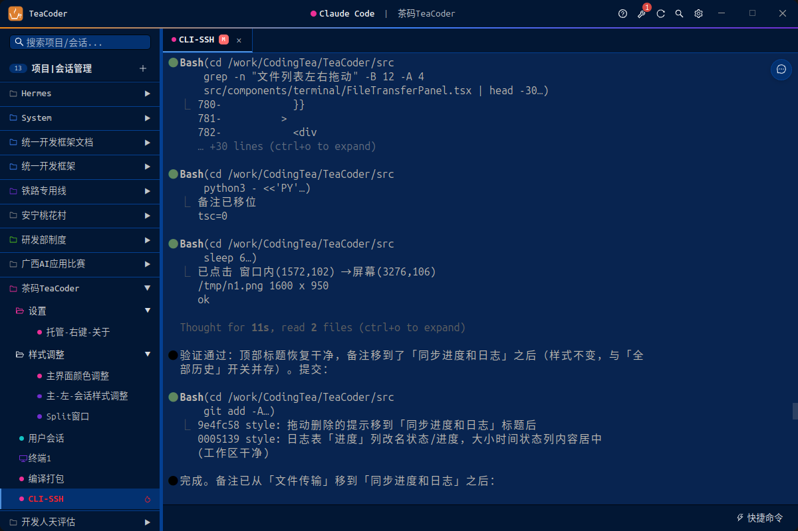
#### 主题示例-暖色系：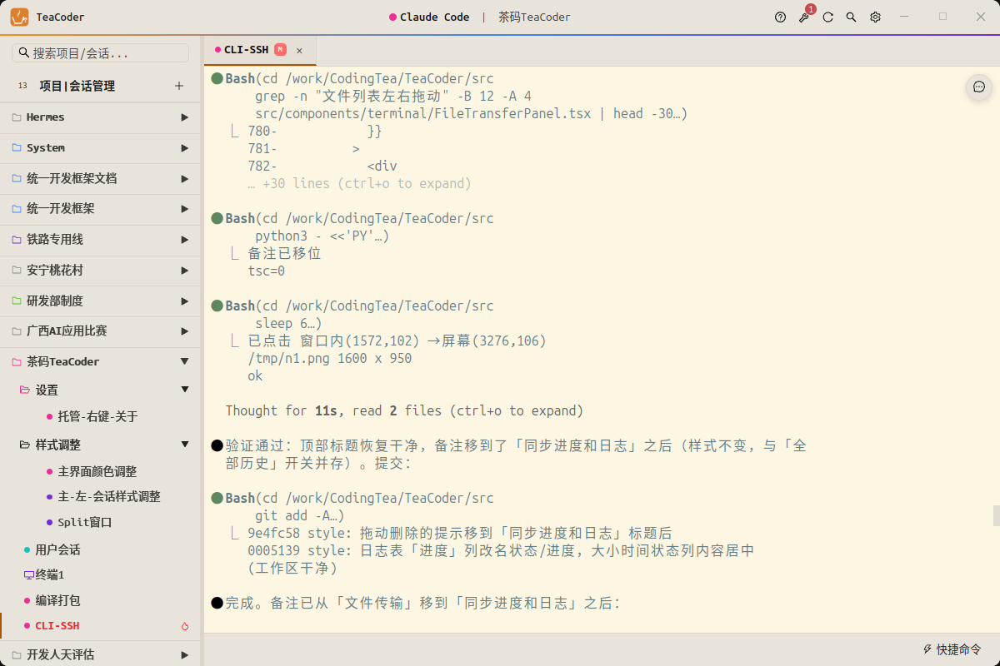
#### 集成SSH,sFTP工具：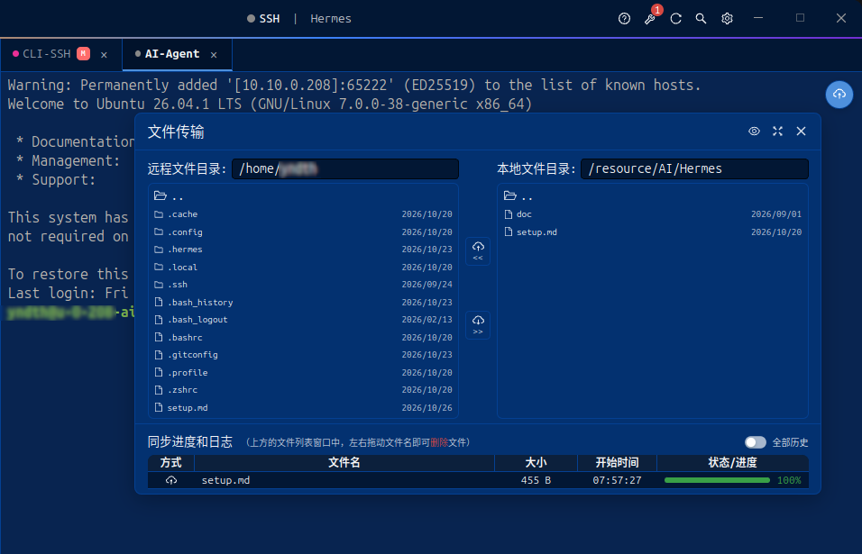
#### 自定义LLM供应商：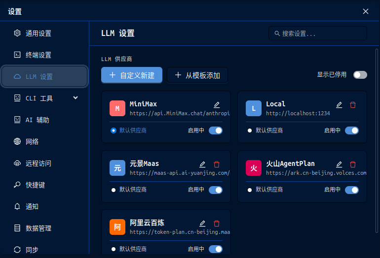
#### 会话独立选择模型，多会话多供应商多模型同时运行：
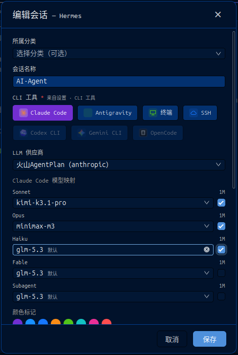
#### 会话历史+搜索+定位：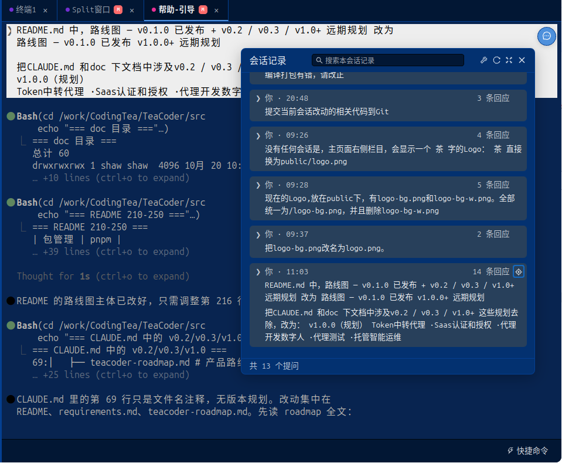
#### 分类型设置快捷命令或代码块：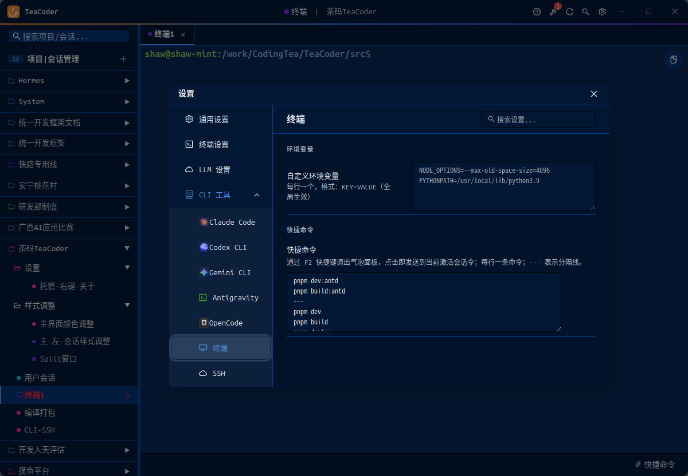
#### 终端快捷命令示例：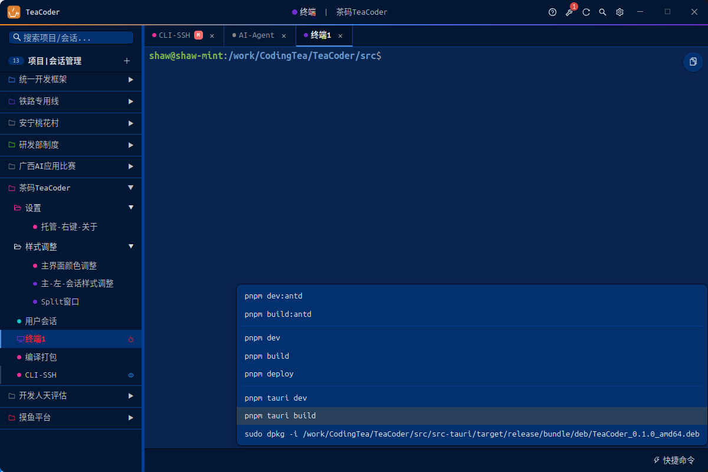
#### Claude终端终端快捷命令示例：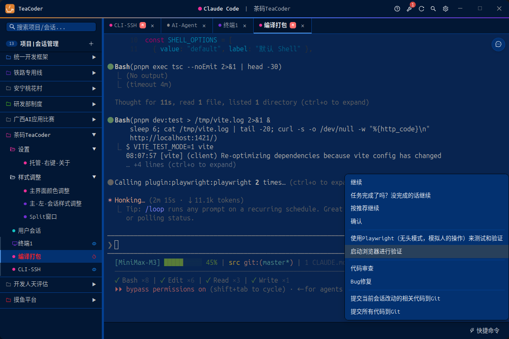
#### 多标签+分屏：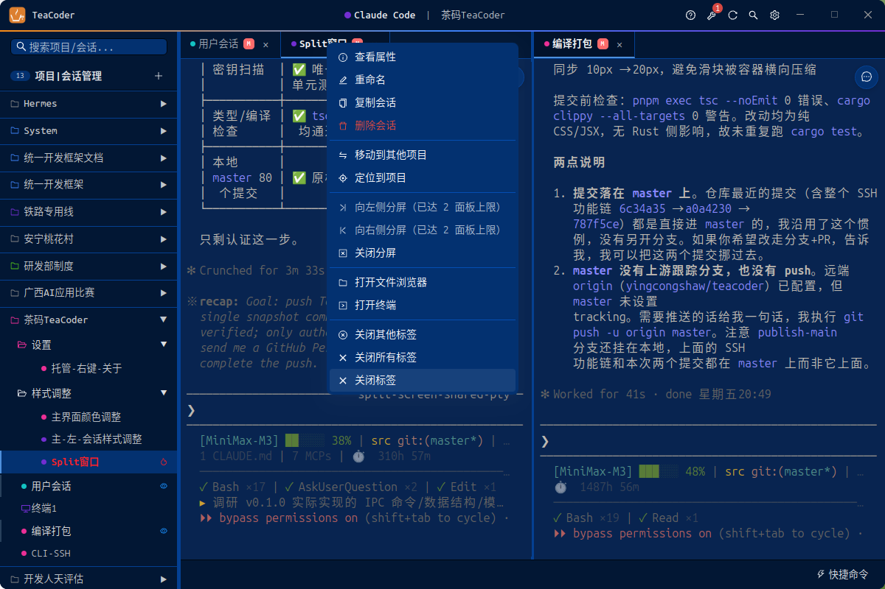


## 系统要求

| 平台 | 最低版本 |
| --- | --- |
| Windows | Windows 10+ |
| macOS | macOS 11 (Big Sur) |
| Ubuntu | 20.04+ |
| 其他 Linux | 主流发行版（提供 AppImage） |

**前置条件**：至少安装一个 AI 编程 CLI 工具：

```bash
# Claude Code
npm install -g @anthropic-ai/claude-code

# Codex CLI
npm install -g @openai/codex

# Gemini CLI
npm install -g @google/gemini-cli

# OpenCode
npm install -g opencode-ai
```


## 快速开始

### 下载安装

前往 [Releases](../../releases) 页面，下载对应平台的安装包：

- Windows：`TeaCoder_0.1.0_x64-setup.exe`（NSIS 安装程序）
- macOS：`TeaCoder_0.1.0_universal.dmg`
- Ubuntu：`teacoder_0.1.0_amd64.deb`
- 其他 Linux：`TeaCoder_0.1.0_amd64.AppImage`

### 首次启动

1. 同意用户协议
2. 完成三步引导
3. 在设置 → LLM 设置 中添加你的 Provider（API Key 或 OAuth）
4. 在设置 → CLI 工具 中确认 Claude / Codex 等已正确检测
5. 在侧边栏新建 Project
6. 在 Project 上点击"新建会话"，选择 CLI 工具 + Provider + 模型 + 工作目录
7. 开始与 AI 编程

### 常用快捷键

| 快捷键 | 作用 |
| --- | --- |
| `Ctrl + T` | 新建会话 |
| `Ctrl + W` | 关闭当前 Tab |
| `Ctrl + Tab` / `Ctrl + Shift + Tab` | 切换 Tab |
| `Ctrl + P` | 搜索会话 |
| `Ctrl + Shift + C` | 复制终端选中内容 |
| `Ctrl + Shift + V` | 粘贴到终端 |


## 开发

### 环境准备

- **Node.js** 20+
- **pnpm** 9+（项目强制使用 pnpm）
- **Rust** stable toolchain
- **Tauri CLI**：`cargo install tauri-cli --version "^2.0"`

### 克隆与启动

```bash
git clone https://github.com/codingtea/TeaCoder.git
cd TeaCoder
pnpm install
pnpm tauri dev
```

### 常用命令

```bash
pnpm tauri dev          # 启动开发模式(热重载)
pnpm tauri build        # 构建发布版本
pnpm exec tsc --noEmit  # TypeScript 类型检查
cargo clippy            # Rust lint(在 src-tauri/ 下)
cargo test              # Rust 单元测试(在 src-tauri/ 下)
```

### 项目目录

```
TeaCoder/
├── src/                    # React 前端
│   ├── components/         # UI 组件
│   │   ├── layout/         # 顶部栏 / 侧边栏 / 主区域 / 状态栏
│   │   ├── terminal/       # xterm.js 终端
│   │   ├── tabs/           # 标签页 + 新建/编辑会话弹窗 + 搜索
│   │   ├── panes/          # 分屏 Pane
│   │   ├── project/        # 项目树
│   │   ├── profile/        # Profile 管理
│   │   ├── cost/           # 费用面板
│   │   ├── cli/            # CLI 工具 UI
│   │   ├── quick-commands/ # 快捷命令面板
│   │   ├── settings/       # 18 个设置页面
│   │   └── onboarding/     # 新手引导
│   ├── stores/appStore.ts  # Zustand 全局状态
│   ├── hooks/              # 自定义 Hooks
│   ├── types/              # TypeScript 类型定义
│   ├── utils/              # IPC / 字体 / 图象 等工具
│   └── themes/             # 主题
├── src-tauri/              # Rust 后端
│   ├── src/
│   │   ├── pty/            # PTY 终端管理(支持 cli / ssh 双路径)
│   │   ├── cli/            # CLI 工具检测与启动
│   │   ├── profile/        # Profile 管理
│   │   ├── llm_provider/   # LLM 供应商系统
│   │   ├── project/        # Project + Session
│   │   ├── session_category/   # 会话分类
│   │   ├── session_message.rs  # 会话消息
│   │   ├── tool_settings/  # per-tool 配置
│   │   ├── crypto/         # 系统 Keychain
│   │   ├── storage/        # SQLite + migrations
│   │   ├── tray.rs         # 系统托盘
│   │   └── commands/       # Tauri IPC 命令
│   ├── migrations/         # schema v1~v12
│   └── tauri.conf.json
├── doc/                    # 项目文档
│   ├── teacoder-roadmap.md # 路线图
│   └── requirements.md     # 需求规格
├── public/                 # 静态资源(logo / CLI 图标)
├── CLAUDE.md               # Claude Code 项目指引
└── README.md               # 本文件
```


## 技术栈

| 层 | 技术 |
| --- | --- |
| 桌面框架 | Tauri 2.x |
| 后端 | Rust (stable) |
| 前端 | React 19 + TypeScript 5 |
| UI 组件 | Ant Design 6 |
| 样式 | TailwindCSS 4（仅布局 / 间距 / 自定义） |
| 状态管理 | Zustand |
| 终端 | xterm.js |
| 持久化 | SQLite (rusqlite) + JSONL |
| 包管理 | pnpm |


## 文档

- 📍 [路线图](./doc/teacoder-roadmap.md) — v0.1.0 已发布 v1.0.0+ 远期规划
- 📋 [需求规格](./doc/requirements.md) — 完整功能需求、数据模型、IPC 命令清单


## 路线图

### v0.1.0（当前版本）✅

多工具终端管理 · 多分屏共享 PTY · LLM 供应商系统 · Profile 隔离 · Token 费用追踪（Claude）· 托盘 + 开机自启 · Onboarding · 18 个设置项

### v1.0.0（规划）
Token中转代理 ·Saas认证和授权 ·代理开发数字人 ·代理测试 ·托管智能运维


## 贡献

欢迎贡献！无论是提 Issue、PR 还是分享使用经验：

- 🐛 **Bug 报告**：[Issues](../../issues) 中按 `bug` 模板提交
- 💡 **功能建议**：[Issues](../../issues) 中按 `feature request` 模板提交
- 🔧 **代码贡献**：Fork → 创建特性分支 → 提交 PR
- 📖 **文档改进**：欢迎直接 PR 修复错别字、补充示例

提交前请阅读 [CLAUDE.md](./CLAUDE.md) 中的编码规范与提交规范。


## 协议

本项目基于 **MIT 协议** 开源，详见 [LICENSE](./LICENSE)。

MIT 协议允许：

- ✅ 商业使用
- ✅ 修改
- ✅ 分发
- ✅ 私用
- ✅ 再许可

唯一要求：在所有副本中保留版权声明与协议声明。


## 致谢

TeaCoder 的诞生离不开以下开源项目：

- [Tauri](https://tauri.app/) — 跨平台桌面应用框架
- [React](https://react.dev/) — 用户界面库
- [Ant Design](https://ant.design/) — 企业级 UI 设计语言
- [xterm.js](https://xtermjs.org/) — 浏览器终端组件
- [Claude Code](https://docs.anthropic.com/en/docs/claude-code) / [Codex CLI](https://github.com/openai/codex) / [Gemini CLI](https://github.com/google-gemini/gemini-cli) / [OpenCode](https://opencode.ai/) / [Antigravity](https://github.com/codingtea/antigravity) — TeaCoder 服务的 CLI 工具

---

## 联系方式

- 作者：苦鼎茶(CodingTea)
- 邮箱：yingcongshaw@gmail.com
- 问题反馈：[GitHub Issues](https://github.com/yingcongshaw/teacoder/issues)

---
